# Plan d'Attaque Renforcé : Relecture Finale & Audit Qualité des Traductions

> **Objectif :** Révision systématique et harmonisation définitive des traductions françaises du projet (**321 traductions locales pré-octobre 2026** + **contrôle de second niveau des mods déjà validés** + **passe de propagation cascade sur tous les patchs liés**).  
> **Norme absolue :** [Translations instructions.txt](file:///e:/Code/SSE%20Translator%20updated/Translations%20instructions.txt) & registre [TRADUCTIONS_VERIFIEES.md](file:///e:/Code/SSE%20Translator%20updated/TRADUCTIONS_VERIFIEES.md).  
> **Priorités absolues :** Mismatches source/trad, élimination du mot-à-mot (traductions littérales), respect du lore officiel Bethesda, intégrité technique et **alignement cascade source $\rightarrow$ patchs**.

---

## 🎯 1. Grille d'Audit en 6 Piliers Critiques

```mermaid
flowchart TD
    Audit["Relecture Finale"] --> P1["1. Mismatches Source / Trad"]
    Audit --> P2["2. Qualité du Français & Anti-Littéralisme"]
    Audit --> P3["3. Respect du Lore & Directives Bethesda"]
    Audit --> P4["4. Textes Anglais Fantômes"]
    Audit --> P5["5. Bugs Techniques & Intégrité Moteur"]
    Audit --> P6["6. Propagation Cascade Source -> Patchs"]

    P1 --> P1a["Désynchronisation de version (mod MAJ, trad obsolète)"]
    P1 --> P1b["Incohérence de concept (ex: anneau vs collier, feu vs glace)"]
    P1 --> P1c["Discordances numériques (pourcentages, durées, coûts)"]
    P1 --> P1d["Ratios de longueur anormaux (texte tronqué)"]

    P2 --> P2a["Éradication des calques de syntaxe anglaise"]
    P2 --> P2b["Formulations idiomatiques et vivantes (français naturel)"]
    P2 --> P2c["Adaptation du registre (oralité des dialogues, journaux)"]

    P3 --> P3a["Lore officiel Bethesda (Mont Écarlate, Vigueur, Septims...)"]
    P3 --> P3b["Harmonisation inter-mods (noms identiques partout)"]
    P3 --> P3c["Cohérence narrative univers Skyrim"]

    P4 --> P4a["Anglais intégral validé 'TranslationComplete'"]
    P4 --> P4b["Noms de métier / PNJs communs non traduits"]

    P5 --> P5a["Variables cassées (&lt;mag&gt;, &lt;dur&gt;, %s, [pagebreak])"]
    P5 --> P5b["Balises numériques corrompues (&lt;10&gt;, &lt;5&gt;)"]
    P5 --> P5c["Balises HTML orphelines (&lt;font&gt;)"]

    P6 --> P6a["Éviter l'écrasement en jeu par ordre de chargement"]
    P6 --> P6b["Propagation automatique des noms et descriptions validés"]
    P6 --> P6c["Audit croisé FormID & Textes sources identiques"]
```

---

## 🔄 2. Règle Fondamentale : Propagation Cascade Source $\rightarrow$ Patchs

> [!IMPORTANT]
> **Pourquoi cette passe est vitale :**  
> Dans Skyrim, un patch de compatibilité se charge **après** le mod source dans le load order. Si un enregistrement (nom d'objet, description de sort, PNJ) a été corrigé et sublimé dans le mod source mais reste dans son ancienne version (ou en anglais) dans le patch de compatibilité, **le patch écrasera la correction en jeu**.

### Mécanisme de la Passe Finale sur les Patchs :
1. **Cartographie des dépendances :** Associer chaque patch à son mod source parent (ex: `LOTD` $\rightarrow$ 30+ patchs d'affichage et de compatibilité ; `Vokriinator` $\rightarrow$ patchs ISC/Apocalypse/CACO ; `Wyrmstooth` $\rightarrow$ patchs UWR/Cause/Curios ; `New Armoury` $\rightarrow$ patchs d'animations/perks ; `Citizens of Tamriel` $\rightarrow$ 7 patchs d'intégration).
2. **Contrôle croisé FormID & Texte original :** Comparer les chaînes partagées entre le mod source validé et le patch.
3. **Propagation systématique des choix validés :** Réinjecter automatiquement la version française validée dans tous les patchs dépendants (zéro divergence terminologique).
4. **Validation de non-régression :** S'assurer qu'aucun patch ne réintroduit une ancienne coquille, un vieux faux-ami (*"barrière"*, *"Trueaz Boule"*, etc.) ou une balise numérique corrompue.

---

## 🔍 3. Focus Détaillé sur les Autres Piliers

### A. Mismatches Source et Traduction (Désynchronisations critiques)
* **Désynchronisation de versions :** L'auteur du mod a changé l'effet d'un atout ou d'un sort dans une mise à jour, mais la traduction conservait l'ancien texte français.
* **Mismatches conceptuels :** L'anglais décrit un effet (ex. *absorption de vigueur*, *lancer double*, *perforation d'armure*) et le français décrit un concept totalement différent (mauvais index / collision de FormID).
* **Discordances numériques de balance :** Écarts de chiffres entre la source et la traduction (`+15 %` vs `+25 %`, durée de sort, coût en magie).
* **Anomalies de volumétrie :** Ratios de longueur anormaux (texte source faisant 4 lignes et traduction réduite à un fragment).

### B. Qualité du Français & Éradication des Traductions Littérales
Conformément à la règle d'or : ***« Traduire le sens, le ton et la personnalité, jamais simplement les mots. »***
* **Suppression des calques syntaxiques :** Bannir les constructions mot-à-mot lourdes (*"Fait que..."*, *"Permet de..."* à répétition, passifs artificiels, calques de structures anglo-saxonnes).
* **Fluidité et naturel :** Le texte doit paraître avoir été écrit nativement en français, avec élégance et spontanéité.
* **Respect strict des registres (Section 3 des instructions) :** Dialogues oraux vivants, journaux personnels intimes, récits immersifs, objectifs de quêtes directs.

### C. Respect des Directives & Canonicité Bethesda
* **Terminologie officielle obligatoire :** *Vigueur* (non endurance), *Magie* (non mana), *Mont Écarlate* (non Montagne rouge), *Septims*, *Receleur/Receleuse* (*Fence*), noms officiels de donjons, factions et créatures.
* **Intégrité technique :** Préservation intégrale des variables (`<mag>`, `<dur>`, `%s`, `$Prompt`), de la pagination `[pagebreak]`, et fermeture des balises HTML ``.

---

## 🛠️ 4. Séquençage Opérationnel en 7 Phases

| Phase | Intitulé & Objectif | Périmètre & Méthode |
| :---: | :--- | :--- |
| **Phase 0** | **Scan Automatisé Global Multi-Critères** | Détection en code sur toute la base (mismatches conceptuels, chiffres divergents, calques/faux-amis, restes d'anglais, variables cassées). |
| **Phase 1** | **Priorité 1 — Systèmes Nolvus & Équilibrages** | `Nolvus Awakening Armors/Weapons/Clothes/Spells Balance Patches` (21 mods, 3 662 chaînes). Risque gameplay et chiffres maximal. |
| **Phase 2** | **Priorité 2 — Gros Blocs Narratifs & Dialogues** | `Remiel` (9 651 chaînes), `Vigile` (7 502 chaînes), `Fanatical Enemies` (4 615 chaînes). Fluidité littéraire et oralité des dialogues. |
| **Phase 3** | **Priorité 3 — Quêtes, Nouveaux Mondes & LOTD** | `Hall of Forgotten` (2 059 chaînes), `DBM Unslaad`, `EEKs Whiterun Interiors`, `Alternate Perspective`. Concordance des artéfacts exposés. |
| **Phase 4** | **Priorité 4 — Refontes de PNJs & Enfants** | `Modpocalypse NPCs` (All Vanilla + Addons) et `RS Children` (28 mods, 2 933 chaînes). Traduction des titres et respect des noms propres. |
| **Phase 5** | **Priorité 5 — Équipements, Armes & Micro-Patchs** | `Dismembering Framework`, `Spear of Skyrim`, et les 91 packs d'armes/armures + micro-patchs unitaires. |
| **Phase 6** | **Contrôle de 2nd Niveau des Mods Validés** | Vérification finale sur les 47 mods majeurs de [TRADUCTIONS_VERIFIEES.md](file:///e:/Code/SSE%20Translator%20updated/TRADUCTIONS_VERIFIEES.md) (sécurité des marqueurs Vokriinator, interfaces MCM UTF-16 LE). |
| **Phase 7** | **Passe Finale de Propagation Cascade Source $\rightarrow$ Patchs** | **Audit croisé exhaustif de tous les patchs de compatibilité.** Propagation automatique des corrections du mod source vers l'ensemble de ses patchs dépendants pour garantir un zéro écrasement en jeu. |

---

## 📑 5. Protocole de Validation & Clôture

1. **Rapport de propagation patchs validé :** Preuve que chaque patch lié reprend fidèlement la traduction officielle de son parent.
2. **Rapport de contrôle final vierge** sur les variables, balises et balises orphelines.
3. **Mise à jour intégrale de [TRADUCTIONS_VERIFIEES.md](file:///e:/Code/SSE%20Translator%20updated/TRADUCTIONS_VERIFIEES.md)** avec décompte exact des chaînes validées et signature finale du projet.
