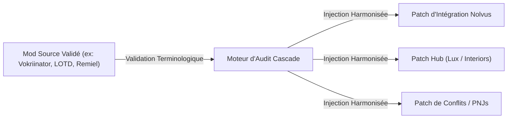

# Plan d'Attaque Renforcé : Relecture Finale & Audit Qualité des Traductions

> **Objectif :** Révision systématique et harmonisation définitive des traductions françaises du projet (**321 traductions locales pré-octobre 2026** + **audit exhaustif de TOUS les patchs créés localement** + **contrôle de second niveau des mods déjà validés** + **passe de propagation cascade sur tous les patchs liés**).  
> **Norme absolue :** [Translations instructions.txt](file:///e:/Code/SSE%20Translator%20updated/Translations%20instructions.txt) & registre [TRADUCTIONS_VERIFIEES.md](file:///e:/Code/SSE%20Translator%20updated/TRADUCTIONS_VERIFIEES.md).  
> **Priorités absolues :** Mismatches source/trad, élimination du mot-à-mot (traductions littérales), intégrité des patchs locaux (les plus sujets aux erreurs), respect du lore officiel Bethesda et **alignement cascade source $\rightarrow$ patchs**.

---

## 🎯 1. Grille d'Audit en 6 Piliers Critiques

```mermaid
flowchart TD
    Audit["Relecture Finale"] --> P1["1. Mismatches Source / Trad"]
    Audit --> P2["2. Qualité du Français & Anti-Littéralisme"]
    Audit --> P3["3. Respect du Lore & Directives Bethesda"]
    Audit --> P4["4. Textes Anglais Fantômes"]
    Audit --> P5["5. Intégrité des Patchs Locaux & Conflits"]
    Audit --> P6["6. Propagation Cascade Source -> Patchs"]

    P1 --> P1a["Désynchronisation de version (mod MAJ, trad obsolète)"]
    P1 --> P1b["Incohérence de concept (ex: anneau vs collier, feu vs glace)"]
    P1 --> P1c["Discordances numériques (pourcentages, durées, coûts)"]
    P1 --> P1d["Ratios de longueur anormaux (texte tronqué)"]

    P2 --> P2a["Éradication des calques de syntaxe anglaise"]
    P2 --> P2b["Formulations idiomatiques et vivantes (français naturel)"]
    P2 --> P2c["Adaptation du registre (oralité des dialogues, journaux)"]

    P3 --> P3a["Lore officiel Bethesda (Mont Écarlate, Vigueur, Septims...)"]
    P3 --> P3b["Harmonisation inter-mods (noms identiques partout)"]
    P3 --> P3c["Cohérence narrative univers Skyrim"]

    P4 --> P4a["Anglais intégral validé 'TranslationComplete'"]
    P4 --> P4b["Noms de métier / PNJs communs non traduits"]

    P5 --> P5a["Patchs Nolvus & custom (les plus sujets aux erreurs)"]
    P5 --> P5b["Variables cassées (<mag>, <dur>, %s, [pagebreak])"]
    P5 --> P5c["Balises corrompues (<10>, <5>) & écrasements d'arbres de perks"]

    P6 --> P6a["Éviter l'écrasement en jeu par ordre de chargement"]
    P6 --> P6b["Propagation automatique des noms et descriptions validés"]
    P6 --> P6c["Audit croisé FormID & Textes sources identiques"]
```

---

## ⚠️ 2. Pourquoi les Patchs Créés Localement Sont la Priorité n°1

Dans une liste de mods moderne (type Nolvus / modlist personnalisée) :
1. **Derniers dans le Load Order :** Les patchs créés localement (équilibrages Nolvus, intégrations d'expérience, patch hubs, résolutions de conflits) se chargent **après** tous les mods maîtres. S'ils contiennent une ligne en anglais, une ancienne traduction non vérifiée ou une balise numérique tronquée, **ils écrasent immédiatement la traduction du mod maître en jeu**.
2. **Sources locales non officielles :** Contrairement aux grands mods issus de la Confrérie des Traducteurs qui ont bénéficié de relectures communautaires, les patchs locaux proviennent souvent de scripts de merge automatiques, d'éditions SSEEdit rapides ou de fichiers générés où les textes anglais n'ont jamais été localisés proprement.
3. **Mismatches de balance et de gameplay :** Les patchs locaux modifient souvent les valeurs d'équilibrage (`fDamageMult`, pourcentages de forge, temps de recharge) tout en conservant l'ancienne description française non mise à jour.

---

## 🔄 3. Règle Fondamentale : Propagation Cascade Source $\rightarrow$ Patchs

1. **Cartographie des dépendances :** Associer chaque patch à son mod source parent (ex: `LOTD` $\rightarrow$ 30+ patchs d'affichage et de compatibilité ; `Vokriinator` $\rightarrow$ patchs ISC/Apocalypse/CACO ; `Wyrmstooth` $\rightarrow$ patchs UWR/Cause/Curios ; `New Armoury` $\rightarrow$ patchs d'animations/perks ; `Citizens of Tamriel` $\rightarrow$ 7 patchs d'intégration).
2. **Contrôle croisé FormID & Texte original :** Comparer les chaînes partagées entre le mod source validé et le patch.
3. **Propagation systématique des choix validés :** Réinjecter automatiquement la version française validée dans tous les patchs dépendants (zéro divergence terminologique).
4. **Validation de non-régression :** S'assurer qu'aucun patch ne réintroduit une ancienne coquille, un vieux faux-ami (*"barrière"*, *"Trueaz Boule"*, etc.) ou une balise numérique corrompue.

---

## 🛠️ 4. Séquençage Opérationnel en 9 Phases Révisées

| Phase | Intitulé & Objectif | Statut | Périmètre & Méthode |
| :---: | :--- | :---: | :--- |
| **Phase 0** | **Scan Automatisé Global Multi-Critères** | ✅ **TERMINÉ** | Détection en code sur toute la base (mismatches conceptuels, chiffres divergents, calques/faux-amis, restes d'anglais, variables cassées). |
| **Phase 1** | **Systèmes d'Équilibrage Nolvus Awakening** | ✅ **TERMINÉ & VALIDÉ** | `Nolvus Awakening Armors/Weapons/Clothes/Spells/Vokriinator Black Balance Patches`. (5 plugins, 1 389 armures, 468 armes, 41 atouts corrigés, recap dans [`recap_modifications_phase1.md`](file:///e:/Code/SSE%20Translator%20updated/recap_modifications_phase1.md)). |
| **Phase 2** | **Audit Exhaustif de TOUS les Patchs Créés Localement & d'Intégration Nolvus** | ✅ **TERMINÉ & VALIDÉ** (2A, 2B, 2C, 2D & 2E validées) | **La phase la plus sensible.** Audit systématique de tous les patchs Nolvus Awakening restants, des patchs d'intégration créés sur mesure, des patch hubs et des résolutions de conflits (détaillée en sous-phases 2A à 2E ci-dessous). |
| **Phase 3** | **Poids Lourds Narratifs & Dialogues (Mods Maîtres)** | ✅ **Validée** | `Remiel - Dwemer Specialist` (9 651 chaînes), `Vigile 1.7.3` (7 502 chaînes), `Fanatical Enemies` (4 615 chaînes), `AkaviriFollower` (321 chaînes). 289 modifications unitaires vérifiées sur disque ([recap_modifications_phase3.md](file:///e:/Code/SSE%20Translator%20updated/recap_modifications_phase3.md)). |
| **Phase 4** | **Quêtes, Nouveaux Mondes & Legacy of the Dragonborn (LOTD)** | ✅ **Validée** | Hall of Forgotten (18 plugins), DBM Unslaad Display Patch (343 chaînes), TCC (18 plugins), Follower Room Patches (128 chaînes), Hjertesten Hall (1 810 chaînes), EEKs Whiterun Interiors, Alternate Perspective. 66 modifications unitaires vérifiées sur disque ([recap_modifications_phase4.md](file:///e:/Code/SSE%20Translator%20updated/recap_modifications_phase4.md)). |
| **Phase 5** | **Refontes de PNJs & Enfants (Sujettes aux écrasements de noms)** | ⏳ En attente | `Modpocalypse NPCs - All Vanilla + Addons` (1 916 chaînes), `True Sons of Skyrim Refined` (605 chaînes), `Pride of Skyrim All In One` (457 chaînes), `Children of the Pariah` (125 chaînes), `RS Children`. Rétablissement des titres français et noms propres vanilla. |
| **Phase 6** | **Équipements, Armes & Armures Dérivées** | ⏳ En attente | `Dismembering Framework`, `Spear of Skyrim`, et les 91 packs d'armes/armures locaux (2 515 chaînes). Concordance des matériaux et tags d'enchantement. |
| **Phase 7** | **Contrôle de 2nd Niveau des Mods Majeurs Déjà Validés** | ⏳ En attente | Audit de sécurité et de non-régression sur les 47 mods majeurs de [`TRADUCTIONS_VERIFIEES.md`](file:///e:/Code/SSE%20Translator%20updated/TRADUCTIONS_VERIFIEES.md) (Apocalypse, Vokriinator Black de base, CACO, Immersive Sounds, Wyrmstooth, Inigo, Auri...). |
| **Phase 8** | **Passe Finale de Propagation Cascade Source $\rightarrow$ Patchs** | ⏳ En attente | **Alignement global définitif.** Comparaison automatique multi-plugins pour injecter toutes les corrections validées des mods maîtres dans l'ensemble des patchs dépendants du load order. |

---

## 🔬 5. Détail Approfondi de la Phase 2 : Les Patchs Créés Localement

Cette phase couvre la totalité des patchs locaux et customisés du projet, regroupés en **5 blocs homogènes** :

### 🔹 Sous-phase 2A : Patchs Systémiques & Gameplay Nolvus Awakening (✅ VALIDÉE — recap_modifications_phase2a.md)
* **Mods concernés :**
  * `Nolvus Awakening Combat Scaling Overhaul - Prepare to Die` (Core, Consistency, Enemy level mult)
  * `Nolvus Awakening AI Patch` (451 chaînes)
  * `Nolvus Awakening Clothes Patch` (384 chaînes) & `Clothes Balance Patch` (262 chaînes)
  * `Nolvus Awakening Gourmet Integration` (198 chaînes)
  * `Nolvus Awakening Stances Perk System` (196 chaînes) & `Ashes of War Stance Framework` (117 chaînes)
  * `Nolvus Awakening Seasonal Plant Mashup` (143 chaînes) & `Custom Outfits` (114 chaînes)
  * `Nolvus Awakening Lighting Patch` (112 chaînes)
  * `Nolvus - Northern Roads Grass Patches` (144 micro-plugins d'intégration de routes et d'herbes)
* **Objectifs :** Éliminer l'anglais résiduel issu de Nolvus, vérifier la concordance des modificateurs de combat, des effets de posture (*Stances*) et de cuisine (*Gourmet*).

### 🔹 Sous-phase 2B : Patchs d'Expérience, Quêtes & Mécaniques Locales (✅ VALIDÉE — recap_modifications_phase2b.md)
* **Mods concernés :**
  * `CCQuest - Experience Patch.esp` (1 594 chaînes — patch local crucial recalibrant l'XP des quêtes Creation Club)
  * `Nolvus Awakening Experience Integration` (573 chaînes — Dawnfang, quêtes vanilla et d'addons)
  * `Lucien - Creation Club Patch` (699 chaînes)
  * `Vokrii - Apply Spell Conditions Fix.esp` (211 chaînes)
  * `Wintersun - Description Fixes` (156 chaînes) & `Wintersun - Tribunal Integration` (106 chaînes)
  * `Complete Crafting Overhaul Remastered - Immersive Sounds Patch` (137 chaînes)
  * `Creation Club Crossbow Integration` (100 chaînes)
  * `Navigator - Navmesh Fixes` (252 chaînes)
  * `Eating Animations and Sounds - Patch Collection` (713 chaînes — Cheesemod, Dawn of Skyrim, Falskaar)
* **Objectifs :** Corriger les intitulés de quêtes, les conditions magiques et s'assurer que les descriptions de religions et d'artisanat sont fluides et fidèles au jeu de base.

### 🔹 Sous-phase 2C : Méta-Hubs de Patchs & Cohérence Monde / Éclairage (✅ VALIDÉE — recap_modifications_phase2c.md)
* **Mods concernés :**
  * `Lux - Patch Hub` (147 plugins, 923 chaînes) & `Lux Orbis - Patch Hub` (98 plugins, 115 chaînes)
  * `JK's Interiors Patch Collection` (147 plugins, 154 chaînes) & `JKs Guild HQ Interiors Patch Collection` (73 plugins, 110 chaînes)
  * `Water for ENB [4K]` (Patchs Falskaar, Beyond Reach, Beyond Skyrim, Wyrmstooth, Lux...)
  * `Embers XD - French` (7 plugins)
* **Objectifs :** Vérifier que les noms de cellules, portes, tavernes, boutiques et sources de lumière ne repassent pas en anglais à cause d'un override d'éclairage.

### 🔹 Sous-phase 2D : Patchs de Conflits PNJs, Races & Apparences (✅ VALIDÉE — recap_modifications_phase2d.md)
* **Mods concernés :**
  * `Modpocalypse NPCs - Patch Collection` (13 plugins d'intégration de PNJs)
  * `True Sons of Skyrim Refined - Nolvus Patch` (281 chaînes)
  * `Fanatical Enemies - Patches` (Consistency, Modpocalypse, Dibella)
  * `DIbella's Blessing - RSV Exclusion Patches` (305 chaînes)
  * `AI Overhaul - Nithi NPC Enhancements Patch Hub` (204 chaînes)
* **Objectifs :** Garantir que les noms de PNJs uniques et les titres de factions ne sont pas corrompus ou traduits de manière incohérente par les patchs d'apparence.

### 🔹 Sous-phase 2E : Micro-Patchs de Compatibilité & Corrections Unitaires (✅ VALIDÉE — recap_modifications_phase2e.md)
* **Mods concernés :**
  * Les **109 dossiers de micro-patchs de compatibilité locaux** répertoriés dans la Catégorie 10 de [`listing_traductions_locales_non_verifiees.md`](file:///e:/Code/SSE%20Translator%20updated/listing_traductions_locales_non_verifiees.md) (110 fichiers, 3 348 chaînes).
* **Objectifs :** Traitement systématique des petits patchs de compatibilité isolés (fixes de scripts, ajustements de caméras, petits ponts de compatibilité).

---

## 🔬 6. Détail de la Phase 3 : Poids Lourds Narratifs & Dialogues (✅ VALIDÉE — recap_modifications_phase3.md)
* **Mods concernés (22 089 chaînes au total) :**
  * Remiel - Dwemer Specialist vostFR (3 fichiers : Base 8 300 chaînes, LOTD 945 chaînes, Beyond Reach 406 chaînes)
  * Vigile 1.7.3 SSE (3 fichiers : ESM 7 070 chaînes, Voiced 427 chaînes, Giant Creatures Fix 5 chaînes)
  * Fanatical Enemies (4 615 chaînes)
  * Akaviri Follower (321 chaînes)
* **Objectifs & Résultats :**
  * **Fanatical Enemies :** Correction du contresens géographique lore Lord of Falkreath traduit par erreur en Seigneur de Faillaise (corrigé en Seigneur d'Épervine).
  * **Remiel Base :** Traduction littéraire intégrale de 288 entrées laissées en anglais (banter avec les autres compagnons, commentaires de la quête de Végétalia/Fléau d'ortie, quête du ragoût et perks de Ferraille).
  * **Vigilant & AkaviriFollower :** Zéro régression, conformité totale confirmée.
  * **Protocole unitaire :** 289 cibles consignées dans le manifeste ; 288 changements effectifs (count == 1) vérifiés sur disque. La cible Fanatical Enemies était déjà à sa valeur finale.

### 📝 Addendum — contre-vérification indépendante des phases 2C à 3 (28/10/2026)

* **Phase 2C :** Les 11 valeurs annoncées sont présentes dans les fichiers concernés. Réserve de traçabilité sur *Darklight Chambers* : le récapitulatif cible `0003CBCB`, tandis que `scripts/apply_subphase_2c_fixes.py` et `scripts/verify_each_phase2bc_mod.py` ciblent `0001529F`. Le texte final de `0003CBCB` est bien présent, mais il faut réaligner le script et la vérification avant de considérer cette ligne comme auditée de bout en bout.
* **Phase 2D :** Les 43/43 valeurs du manifeste correspondent aux entrées actuelles ; les noms contrôlés dans la traduction USSEP concordent.
* **Phase 2E :** Les 5/5 valeurs du manifeste correspondent aux entrées actuelles.
* **Phase 3 :** Les 288 traductions Remiel du manifeste correspondent aux entrées actuelles ; aucune source n’est restée identique et les marqueurs sont préservés. Le manifeste contient une ligne Fanatical Enemies sans changement réel (`old_value == new_value`), et cette valeur « avant » diffère de celle donnée par le récapitulatif.
* **Finition française Remiel à intégrer à la passe finale :** corriger les doubles virgules (`05B4AC25`, `05B3B83D`), remplacer les six formulations genrées non naturelles `prudent(e)` par une formulation neutre (`05B4AC00`, `05B4FD4D`, `05B4ABB5`, `05B4ABE6`, `05B4AC1B`, `05B4097A`) et supprimer la virgule superflue avant le point d’interrogation (`05B4ABD1`).
* **Statut de suivi :** 2D et 2E sont conformes au contrôle des valeurs sur disque. La 2C garde une réserve de traçabilité ; la phase 3 garde les corrections éditoriales ci-dessus et la rectification du décompte à 288 changements réels.

---

## 🔬 7. Détail de la Phase 4 : Quêtes, Nouveaux Mondes & LOTD (✅ VALIDÉE — recap_modifications_phase4.md)
* **Mods concernés (5 816 chaînes au total sur 95 plugins) :**
  * Legacy of the Dragonborn - Hall of Forgotten (18 plugins, 1 740 chaînes) & extensions
  * DBM Unslaad Display Patch (343 chaînes)
  * Legacy of the Dragonborn - Hall of Forgotten - TCC (18 plugins, 36 chaînes)
  * Legacy of the Dragonborn - Follower Room Patches (4 plugins, 128 chaînes : Auri, Inigo, Lucien, Remiel)
  * Hjertesten Hall (1 810 chaînes)
  * EEKs Whiterun Interiors (261 chaînes)
  * Alternate Perspective (Base, Sovngarde, Beginnings, 701 chaînes)
  * Quêtes secondaires et intérieurs (Bruma, Sky Haven Temple, Riften...)
* **Objectifs & Résultats :**
  * **Concordance Musée Unslaad :** 40 plaques d'exposition du patch DBM Unslaad réalignées mot à mot sur le master Unslaad.esm pour que le libellé de l'exposition corresponde exactement à l'objet dans l'inventaire du joueur.
  * **Outils du Conservateur (TCC) :** 18 messages de complétion harmonisés sur la norme officielle (Les Outils du Conservateur - Mod complété (...)).
  * **EEKs Whiterun Interiors :** Rétablissement de valeurs nulles (PNJ Aalia) et correction lore de la flore (Fleurs rouges de montagne).
  * **Identity Crisis :** Éradication des suffixes résiduels anglais (replica) en (réplique).
  * **Protocole unitaire :** 66 modifications unitaires appliquées (count == 1) et vérifiées sur disque.

---

## 📑 8. Protocole de Validation & Clôture par Phase

1. **Génération d'un fichier récapitulatif `recap_modifications_phaseX.md`** avec tableau complet :
   `FormID | Mod source | Texte original (EN) | Avant | Après | Nature du correctif`.
2. **Contrôle d'intégrité automatisé :** 0 balise `<...>` corrompue, 0 balise HTML non fermée, 0 variable perdue (`<mag>`, `<dur>`, `%s`, `[pagebreak]`).
3. **Mise à jour immédiate du registre [`TRADUCTIONS_VERIFIEES.md`](file:///e:/Code/SSE%20Translator%20updated/TRADUCTIONS_VERIFIEES.md)** avec le nombre exact de chaînes auditées et validées.
